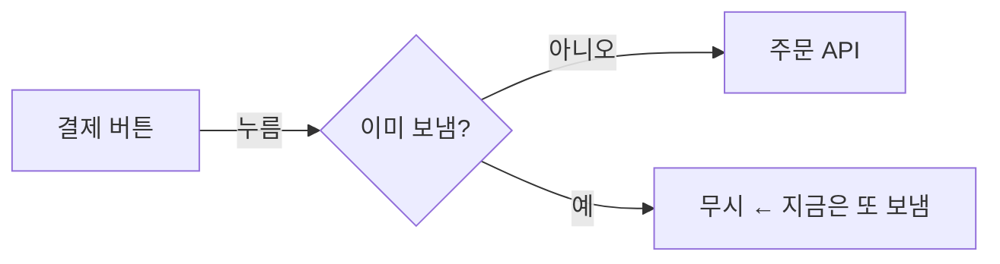

# Task Board (board, 옛 이름 확인판)

사용자는 세션 여러 개를 동시에 돌린다. 채팅에 쓴 질문·보고는 스크롤에 묻혀 놓친다. 그래서 **모든 작업을 Task Board 로** 한다
(2026-11-09 사용자 "이제 모든 작업은 테스크보드로" — 그 전엔 물을 것·알림만이었다). 채팅으로 일을 받아도 먼저 문서를 만든다.
작업 하나 = 문서 하나(`board` 화면의 탭 하나). 문서가 원본이고, 사용자는 화면(또는 편집기)에서 답·메모·이미지를 넣는다.

## 순서

1. 이 세션 이름을 확인한다 — `ListAgents` 맨 위 "This session is <이름> [<ref>]".
2. `board list` 로 이 세션의 진행 중 작업이 이미 있는지 본다. 같은 작업이면 그 문서에 이어 쓴다.
   없으면 만든다: `board new <작업-이름> --title "<한 줄 제목>" --session "<이름> [<ref>]"`
   (작업 이름은 영어·한글·숫자·`-` — 경로가 된다. 예: `gamepad-control-screens`)
3. 출력된 `task.md` 를 Read 한 뒤 Edit 로 채운다(형식 아래). 일하는 동안 계속 고쳐 쓴다:
   지금 상태는 `## 요약`(3줄 안, 최신으로 덮어씀 — **첫 줄은 `지금: <하는 일·기다리는 것 한 줄>`**, 목록·작업 맨 위에 그대로 보인다), 진행·완료 보고와 결과는 `## 알려 드릴 것`(새것을 맨 위에, `11-09 14:30` 처럼 시각과 함께),
   물을 것은 `## 정할 것`. 근거 자료 전문·로그는 넣지 말고 경로만.
4. 채팅엔 한 줄만: `Task Board <작업> 갱신 — <board url <작업>>`(물을 게 있으면 `… 에 Q1~Q3 올렸습니다 — …`).
   표·목록·긴 설명·보고는 채팅에 쓰지 않는다. 한 줄로 끝나는 답("완료?" → "네, 끝났습니다 — <주소>")은 그 한 줄이면 된다.
5. **받는 법은 `board new` 출력 마지막 줄을 따른다.**
   - **"채널로 연결돼 있어"** → 아무것도 걸지 않는다. [보내기]가 `<channel source="board" task="<작업>">` 로 이 세션에 들어온다
     (쉬고 있어도 깨어난다, 바쁘면 끝난 뒤 들어온다). 사용자가 직접 보낸 것이니 채팅 답과 같이 다룬다 — 아래 반영 절차 그대로.
     채널 세션 = 대화형 `claude` 를 `--dangerously-load-development-channels server:board` 로 띄운 세션(래퍼 `bin/claude` 가 붙인다).
   - **"채널이 없다"** → `board wait <작업>` 을 Bash `run_in_background` 로 건다. 사용자가 [보내기]를 누르면 끝나고 이 세션이 깨어난다.
     `board wait` 가 exit 5 로 끝나면 채널 세션이다 — 다시 걸지 않는다.
   - 받으면(채널이든 wait 출력이든) 보낸 답이 찍혀 있다. **task.md 를 다시 Read** 하고 질문마다 `⇒` 로 반영, 결정된 건 `[v]`, 새로 물을 것은 새 질문으로.
   - wait 세션은 그리고 다시 `board wait` 를 건다. exit 3(시간 초과)이면 그냥 다시 건다.
   - 한 세션이 작업 여럿이면 `board wait a b` 로 한 번에.
6. **끝나면 그 자리에서 `board done <작업>`** — 완료 보고를 쓴 그 수정에서 바로(열어 두는 버릇을 사용자가 지적, 11-11). '끝난 작업' 목록으로 내려간다(지우지 않는다).
   사용자 확인만 남았으면 질문으로 묻고 답이 오면 닫는다. 남은 게 기다림(외부 승인·남의 머지)뿐이면 `지금: … 기다림` 으로 열어 둔다.

사용자가 채팅으로 답해도 **문서에 반영한다**(문서가 원본). 반영 뒤 채팅엔 한 줄.

## 문서 형식 (`task.md`)

````markdown
---
title: 결제 버튼이 두 번 눌리면 주문이 두 번 들어가는 문제
session: 버그 고치기 [756bdf]
status: 진행 중
---
## 요약
지금: 두 번째 누름을 막을지 Q1 답 기다림
무엇을 왜 하고 있고 어디까지 왔는지 2줄 이내.

## 그림


## 정할 것
### [ ] Q1. 두 번째 누름을 막을까?
A 막는다(추천 — 이유 한 줄) · B 경고만 · C 그대로

### [v] Q2. 이미 정한 것
-> ㅇㅋ
⇒ A 로 반영했습니다(커밋 abc123).

## 알려 드릴 것
- 답이 필요 없지만 놓치면 안 되는 것

## 메모
-> (사용자가 화면에서 쓴, 질문과 상관없는 말 · 이미지)
⇒ (세션 답)
````

- 질문 머리는 정확히 `### [ ] <ID>. <질문 한 줄>` — 화면이 이 줄로 질문 카드를 만든다. 상태: `[ ]` 미정 · `[~]` 방향만 · `[v]` 결정.
- **제목과 질문 머리는 목록에 그대로 보인다** — 화면 왼쪽 세션별 목록이 작업 제목과 '내 차례' 질문 머리(최대 3개)를 보여 준다.
  눌러 보지 않아도 무엇을 정해야 하는지 알게 쓴다. 제목 = 무엇을·지금 무슨 결정이 필요한지("옵션 패키지 첫 PR — 올리기 승인"),
  질문 머리 = 정할 것 자체("Q1. #1218 머지해도 될까?"). "확인", "질문" 같은 빈 머리 금지(11-03 사용자: "눌러봐야 뭔지 아니까").
- `-> ` 로 시작하는 줄은 **사용자 답** — 세션은 고치지 않는다. 세션 답은 `⇒ ` 로 시작해 그 질문 맨 끝에 붙인다.
  여러 줄이면 바로 다음 줄들을 빈 줄 없이 이어 쓴다.
- "내 차례" 판정: 질문의 마지막 말이 세션(`⇒`)이거나 아직 아무 말도 없으면 사용자 차례. 그래서 되물을 때는 `⇒` 로 묻는다.
- 진행 중인데 세션이 쉬고(꺼짐 포함) 사용자 차례 질문도 없으면 화면은 '확인 필요 — 세션 멈춤'으로 띄운다. 남이 할 일만 기다리면 `지금: … 기다림`.
- 질문엔 선택지와 **추천**을 같이 — 추천대로면 사용자는 "ㅇㅋ" 만 쓴다.
- 그림이 이해를 돕는 구조·흐름·비교면 ```` ```mermaid ```` 로 노드·엣지를 그린다(화면이 그려 준다). 장식용 그림은 넣지 않는다.
- 사용자가 붙인 이미지는 `` 로 들어온다 — 작업 폴더 기준 경로를 Read 하면 보인다.
- 문서는 짧게. 근거 자료 전문·로그는 넣지 말고 경로만.

## 지킬 것

- **고치기 전에 항상 다시 Read.** 사용자가 화면에서 쓰는 중일 수 있다. Edit 가 "파일이 바뀌었다"로 실패하면 다시 읽고 고친다.
- `-> ` 줄은 사용자 것 — 지우거나 고치지 않는다. 사용자가 화면에서 보낸 말은 그 질문(또는 `## 메모`) 끝에 `-> ` 로 쌓인다.
- `## 메모` 는 질문과 상관없는 사용자 말이 오는 곳이다 — `board wait` 출력에 "메모:" 가 있으면 그 아래 `⇒ ` 로 답한다.
- 화면 주소·문서 폴더는 `board url`, `board list` 로 확인한다 — 경로를 외워 쓰지 않는다.
- **`board wait` 는 꺼질 수 있다**(채널 세션은 해당 없음 — 걸어 둔 것이 없다) — PC 메모리가 모자라면 Claude Code 가 쉬는 세션의 백그라운드 셸을 정리한다(11-04 밤 4개 세션이 못 깸).
  사용자가 "Task Board 깨워 줘"·"확인판 깨워 줘"·"보냈는데 답이 없어" 하면 `board orphans` — 보냈는데 듣는 세션이 없는 작업과 보낼 문구가 나온다.
  `ListAgents` 뒤 그 세션에 그대로 `SendMessage` 한다. 화면에도 듣는 세션이 없는 작업은 경고가 뜬다.

## 사용자가 보드에서 맡긴 작업

배달 글 첫 줄이 `(새 작업 — 사용자가 Task Board 에서 이 세션에 맡겼다 …)` 면 사용자가 [＋ 새 작업]으로 이 세션에 직접 만든 작업이다(문서 머리 `from: board`).
그 문서가 이 세션의 작업 문서다 — `board new` 하지 말고, 메모의 할 일을 일로 받아 요약 `지금:` 을 고치고 메모에 `⇒` 로 받았다고 한 줄, 진행·물을 것·결과는 그 문서에. 끝나면 `board done`.

## 밖(폰)에서 보기 — 세션이 할 일은 없다

사용자는 자기 도메인(https)으로 같은 화면을 폰에서 본다 — Cloudflare 터널이 이 PC 의 '밖의 문'(127.0.0.1:BOARD_PUBLIC_PORT)에 붙고,
로그인은 슬랙 DM 으로 받은 6자리 코드(한 번 하면 그 기기는 3달). 세션은 아무것도 올리지 않는다 —
아티팩트 연동은 2026-11-12 사용자가 뺐다("너무 복잡한것같아서"). `board push`·`pushed`·`reply`·`hubpage` 명령은 없다.

- **🔔 = 끝 알림.** 사용자가 작업 화면에서 🔔 를 켜 두면, 그 작업이 끝(`board done`)이 되는 순간 서버가 사용자 슬랙 DM 으로 한 번 알린다.
  그래서 일이 끝나면 그 자리에서 `board done` 하는 것이 더 중요하다 — 늦게 닫으면 알림도 늦다.
- **작업이 끝(`board done`)이 되는 순간 이 PC 화면 위에 배너가 뜬다**(모든 작업, 세션마다 이모지·색이 다름) — 사용자는 이걸로 끝난 걸 안다. 늦게 닫으면 늦게 뜬다.
- 그 배너는 세션이 직접 꾸민다 — `board banner`(설정 파일 `$BOARD_DIR/.banners/<세션 이름>.json`: emoji·colors·heads·confetti·css) → 고치고 `board banner --shot` 으로 PNG 를 Read 해 보며 다듬는다.
- 그 밖의 알림은 없다. 자리 비움 폰 알림(PushNotification)·내 차례 PC 알림은 없앴다(11-12 사용자 "보지도 않아").
- 회사 내부 자료(결재 문서 번호·금액·사람 이름 등)가 들어가는 작업은 문서 머리에 `local: yes` — 밖의 문에선 안 보이고 이 PC 화면에만 보인다.
